# 实验3 卷积神经网络实验报告

姓名：尹传林　学号：24110041036

| 项目 | 内容 |
| --- | --- |
| 课程 | 中国海洋大学26秋《软件工程原理与实践》 |
| 实验名称 | 实验3 卷积神经网络 |
| 实验日期 | 2026年10月16日 |
| 实验内容 | MNIST 全连接与卷积网络对照、LeNet 与简化 VGG 的 CIFAR-10 分类 |
| 课程要求 | [OUC AI Lab 实验3](https://oucai.club/classes/se/lab03) |
| 报告与代码仓库 | [Yin-C-L/SE_Lab3_CNN](https://github.com/Yin-C-L/SE_Lab3_CNN) |
| 个人博客 | 选做，本次未另行发布 |

## 一 实验内容

### 1 实验目标与基本原理

本次实验通过三项代码练习，观察卷积神经网络如何从图片中提取特征，以及网络结构和数据处理对分类结果的影响。MNIST 原图 CNN 的测试准确率为 94.32%；CIFAR-10 上，LeNet 和简化 VGG 的最终测试准确率分别为 63.81% 和 80.36%。所有结果均来自本次保存的 Notebook 输出，而非指导中的示例数值。

卷积层使用局部连接和共享权重提取特征，不必为图片的每个位置单独学习一套参数。池化层缩小特征图，减少后续计算，但也会舍弃部分位置信息。全连接层将提取到的特征组合成类别分数。ReLU 引入非线性，使多层网络能够学习比线性变换更复杂的关系。

结合课程列出的典型网络，我整理了以下区别。AlexNet 展示了深层 CNN 配合 ReLU 和 GPU 训练的有效性；VGG 主要通过重复堆叠小卷积核构建更深的网络；GoogLeNet 的 Inception 模块用不同分支提取不同尺度的特征，并通过 1×1 卷积控制通道数；ResNet 引入残差连接，改善深层网络的优化。本次实际训练的是指导采用的简化 VGG，没有另外训练 AlexNet、GoogLeNet 或 ResNet。[5][6][7][8]

### 2 运行环境与实验设置

| 项目 | MNIST 对照实验 | LeNet 实验 | 简化 VGG 实验 |
| --- | --- | --- | --- |
| 运行位置 | Google Colab | Google Colab | 本机 Windows |
| GPU | Tesla T4 | Tesla T4 | RTX 5060 Laptop GPU |
| Python | 3.13.15 | 3.13.15 | 3.12.14 |
| PyTorch | 2.11.0+cu130 | 2.11.0+cu130 | 2.8.0+cu128 |
| Torchvision | 0.26.0+cu130 | 0.26.0+cu130 | 0.23.0+cu128 |
| 随机种子 | 42 | 42 | 42 |
| 训练与测试样本数 | 60,000 / 10,000 | 50,000 / 10,000 | 50,000 / 10,000 |
| 训练轮数 | 每组 1 轮 | 10 轮 | 10 轮 |
| 训练与测试 batch size | 64 / 1000 | 64 / 8 | 128 / 128 |
| 优化器 | SGD | Adam | Adam |
| 学习率 | 0.01，momentum=0.5 | 0.001 | 0.001 |

三个实验均使用完整真实数据，`smoke_test=False`。训练集打乱样本顺序，测试集固定顺序；训练时使用 `model.train()`，测试时使用 `model.eval()` 和 `torch.inference_mode()`。三个 Notebook 的代码单元均已执行，未记录错误输出。

实验三、四的证据来自 Colab；实验五按实际运行情况记录为本地 GPU，不能将其视为 Colab 在线运行的证明。不同设备和软件版本也意味着不能只凭这些实验比较训练速度。

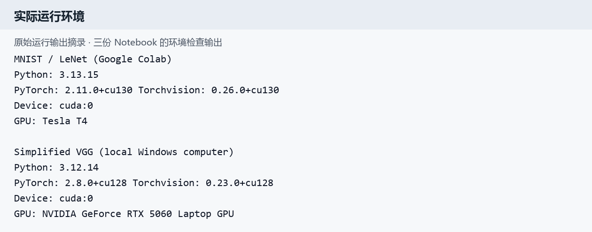

图1：环境检查的真实文本输出。报告中的样本图、曲线和预测图直接提取自 Notebook 内嵌 PNG；标有“输出摘录”的图片由原始日志重新排版，不是模拟的 Colab 浏览器界面。

### 3 代码练习一 MNIST 分类与像素置换对照

#### 3.1 数据处理与网络结构

MNIST 每张图片为 28×28 的单通道灰度图，像素只表示明暗，没有 RGB 三个颜色通道；标签为 0 到 9。训练前使用 `ToTensor()`，再按均值 0.1307、标准差 0.3081 标准化。

全连接网络将图片展平为 784 个数，采用 `784→8→8→10` 的结构，参数量为 6,442。CNN 使用两次 5×5 卷积和两次 2×2 最大池化，最后接全连接层，参数量为 6,422。两者参数量接近，但并非完全相等。[2]

| CNN 处理步骤 | 单张图片的输出形状 |
| --- | --- |
| 输入 | 1×28×28 |
| 第一次卷积 | 6×24×24 |
| 第一次池化 | 6×12×12 |
| 第二次卷积 | 6×8×8 |
| 第二次池化 | 6×4×4 |
| 展平与分类 | 96→50→10 |

两个网络最后输出 `LogSoftmax`，配合 `NLLLoss` 训练。每组只训练 1 个 epoch，所以结果反映的是这一训练预算下的表现，不能直接当作充分训练后的性能上限。

#### 3.2 固定像素置换的操作

为了检查 CNN 对空间结构的利用，我将图片的 784 个像素按照固定排列重新放置。训练集和测试集使用同一排列，两个置换实验也复用同一排列，然后分别从头训练 FNN 和 CNN。置换没有删除像素数值，但破坏了原来的局部邻接关系。

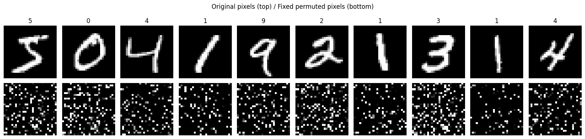

图2：上排是原图，下排是固定置换后的图。下排看起来像噪声，但每个像素位置的对应规则是固定的，因此不是每次随机更换的无规律噪声。

#### 3.3 四组结果与分析

| 模型与输入 | 参数量 | 训练损失 | 测试损失 | 测试准确率 |
| --- | --- | --- | --- | --- |
| FNN 原图 | 6,442 | 0.8717 | 0.4142 | 87.97% |
| CNN 原图 | 6,422 | 0.5522 | 0.1820 | 94.32% |
| FNN 固定置换 | 6,442 | 0.8690 | 0.4348 | 87.00% |
| CNN 固定置换 | 6,422 | 1.3213 | 0.5349 | 83.72% |

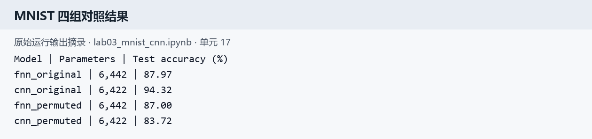

图3：最终汇总输出，每组准确率均在 10,000 张测试图片上计算。

原图上 CNN 比 FNN 高 6.35 个百分点，说明在参数量接近、相同训练轮数的设置下，卷积结构更适合利用数字笔画的局部关系。置换后 FNN 下降 0.97 个百分点，CNN 下降 10.60 个百分点，CNN 失去了原本有利的局部结构。

FNN 对固定置换的下降较小，不等于已经训练好的 FNN 对任意置换都不敏感。这里是换了输入表示后重新训练，网络能够重新学习各个位置与标签的对应关系。

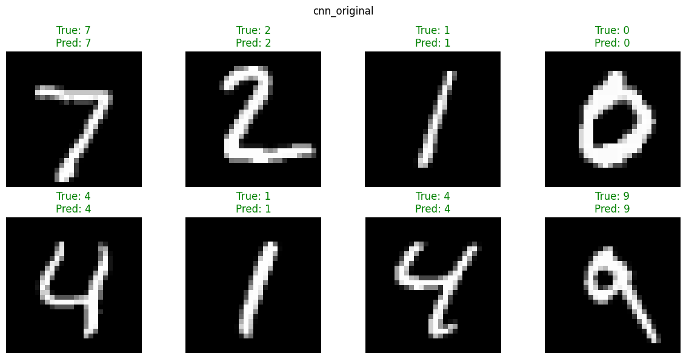

图4：展示的 8 张图片均预测正确，但这只是固定样本的可视化，不能用“8 张全对”代替完整测试集的 94.32%。

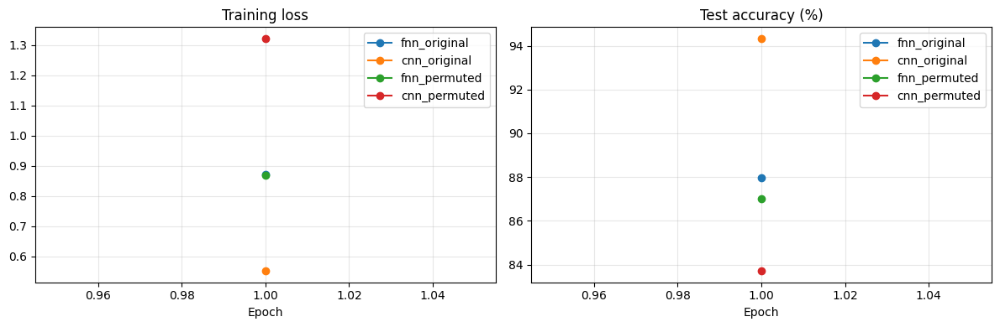

图5：每组仅训练 1 轮，因此横轴只有 epoch=1 的一个点，并不是曲线缺失或程序故障。

### 4 代码练习二 LeNet 对 CIFAR10 分类

#### 4.1 数据与模型

CIFAR-10 包含飞机、汽车、鸟、猫、鹿、狗、青蛙、马、船和卡车 10 类图片。每张图片为 3×32×32，训练集 50,000 张，测试集 10,000 张。与 MNIST 相比，图片包含颜色、复杂背景和更大的物体外观变化。

本实验采用 LeNet 风格网络：`Conv(3,6,5)→ReLU→MaxPool→Conv(6,16,5)→ReLU→MaxPool`，随后展平并经过 `400→120→84→10` 的全连接层。参数量为 62,006。数据不使用随机增强，三个通道均采用均值 0.5、标准差 0.5 标准化。[3]

| 步骤 | 单张图片的输出形状 |
| --- | --- |
| 输入 | 3×32×32 |
| 第一次卷积与池化 | 6×28×28 → 6×14×14 |
| 第二次卷积与池化 | 16×10×10 → 16×5×5 |
| 展平与全连接 | 400→120→84→10 |

输出是 10 个原始类别分数，使用 `CrossEntropyLoss`；不在损失函数前额外添加 Softmax。Adam 学习率为 0.001，训练 10 轮，每轮均测试完整的 10,000 张图片。

#### 4.2 训练过程与最终结果

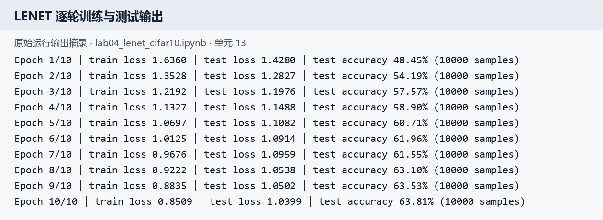

图6：从 Notebook 提取的逐轮日志。训练损失由 1.6360 降到 0.8509，测试准确率由 48.45% 提高到 63.81%。

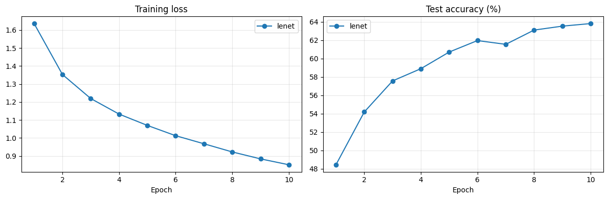

图7：第 7 轮准确率有小幅回落，之后继续上升。训练损失整体下降，但测试表现不保证逐轮单调改善；应观察多轮趋势，而不是只看某一个 batch。

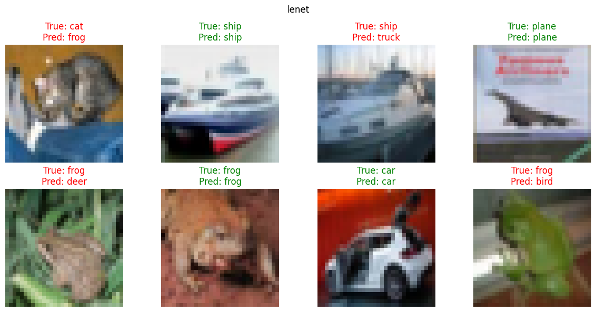

图8：绿色表示预测正确，红色表示错误。例如第一张猫被识别为青蛙，第三张船被识别为卡车，说明网络仍可能混淆局部外观。固定 8 张样本只是错误示例，不能据此推算全测试集的分类分布。

最终准确率 63.81% 对应 10,000 张测试图中 6,381 张正确、3,619 张错误。它接近指导的约 64%，但报告保留实际小数结果，没有为了匹配指导而修改成绩。

### 5 代码练习三 简化 VGG 对 CIFAR10 分类

#### 5.1 与 LeNet 的主要差别

本实验继续使用相同的 CIFAR-10 数据划分，但换成指导实际给出的简化 VGG：8 个 3×3 卷积层、5 次最大池化，每个卷积后接 BatchNorm 和 ReLU，最后用一个线性层输出 10 类。它不是包含 13 个卷积层和 3 个全连接层的完整 VGG16，实际参数量为 9,231,114。[4][5]

网络通道配置为 `64-M-128-M-256-256-M-512-512-M-512-512-M`，其中 M 表示池化。3×3 卷积使用 `padding=1`，保持该次卷积前后的宽高；5 次池化将宽高从 `32→16→8→4→2→1`。最后的特征为 512×1×1，因此分类层必须为 `Linear(512,10)`。

训练图片新增 `RandomCrop(32,padding=4)` 和随机水平翻转。前者先把边界各补 4 个像素，再随机裁出 32×32 区域；后者让部分图片左右镜像。它们增加了训练时的外观变化，但没有改变样本标签，也没有把训练集变成更多张固定原图。测试集不采用随机增强。

三个颜色通道的标准化均值为 `(0.4914,0.4822,0.4465)`，标准差为 `(0.2023,0.1994,0.2010)`。BatchNorm 处理的是网络中间特征，与输入处的 Normalize 不同；测试前切换 `eval()`，避免继续使用训练模式的批次统计行为。

#### 5.2 运行结果与曲线分析

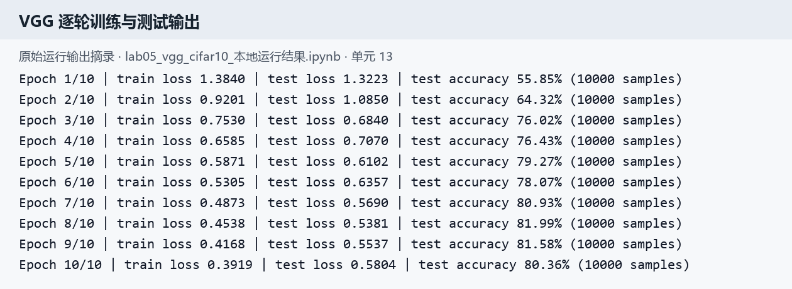

图9：本机 GPU 上的实际输出，每轮评估 10,000 张测试图片。第 10 轮测试准确率为 80.36%，不是指导示例中的 84.92%。

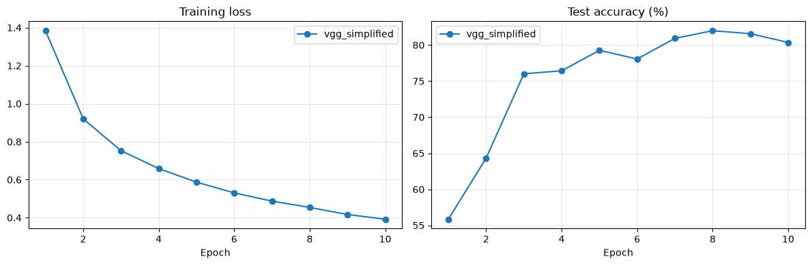

图10：训练损失从 1.3840 持续下降至 0.3919；测试准确率在第 8 轮达到本次观测最高值 81.99%，之后第 9、10 轮分别为 81.58% 和 80.36%。测试损失也从第 8 轮的 0.5381 上升到最后的 0.5804，说明继续拟合训练数据没有带来同步的测试收益，存在过拟合迹象或训练波动。

最终结果按预先设定的第 10 轮记录为 80.36%，没有事后把测试集最高值当作最终成绩。若后续使用早停或选择最佳权重，应从训练集划出验证集，不能反复利用测试集挑模型。

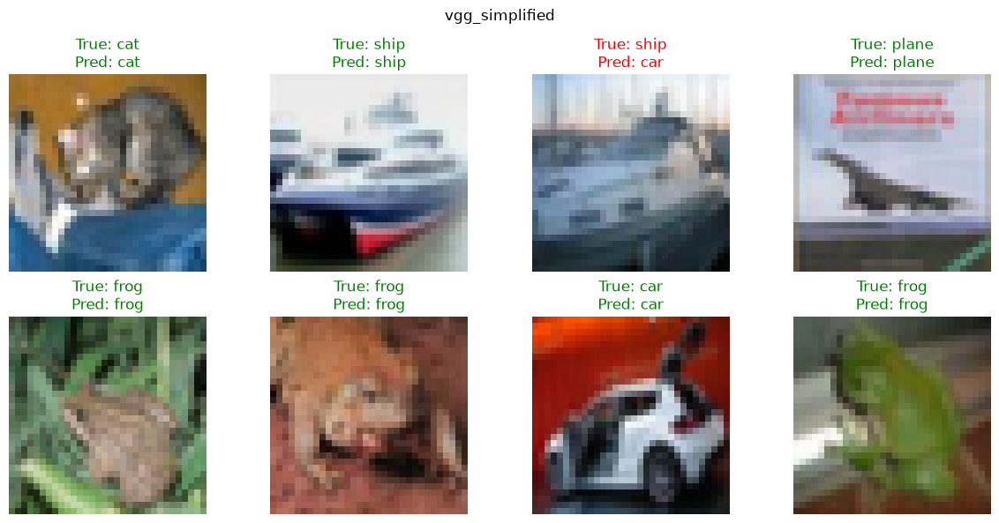

图11：与 LeNet 展示的是同一批测试图片。VGG 正确识别了第一张猫以及部分 LeNet 识别错误的青蛙，但第三张船仍被识别为汽车。局部示例显示改进，也提醒我模型并没有完全解决分类问题。

#### 5.3 CIFAR10 两种设置的综合比较

| 指标 | LeNet | 简化 VGG |
| --- | --- | --- |
| 参数量 | 62,006 | 9,231,114 |
| 卷积层数 | 2 | 8 |
| 随机数据增强 | 无 | 裁剪和水平翻转 |
| BatchNorm | 无 | 有 |
| 最后一轮训练损失 | 0.8509 | 0.3919 |
| 最后一轮测试损失 | 1.0399 | 0.5804 |
| 最后一轮测试准确率 | 63.81% | 80.36% |

VGG 的最终准确率提高了 16.55 个百分点，测试错误数从 3,619 减少到 1,964。但两组同时改变了结构、增强、标准化和 batch size，且运行环境不同，因此这不是只改变网络深度的严格消融实验，不能把全部提升归因于层数增加。VGG 参数量也约为 LeNet 的 149 倍，准确率与模型规模需要一起考虑。

## 二 问题总结与体会

### 1 DataLoader 中 shuffle 取不同值有什么区别

`shuffle=True` 会在每次遍历训练集时重新打乱取样顺序，使不同 batch 的组成发生变化，减少固定顺序对优化的影响。它打乱的是“图片之间的先后顺序”，不会打乱一张图片内部的像素，也不会把图片与标签的对应关系拆开。

`shuffle=False` 保持固定顺序，便于重复查看相同测试样本。本实验训练集为 True、测试集为 False。在模型处于正确的 eval 模式并统计完整测试集的条件下，改变测试顺序通常不会改变总体准确率；不能把测试集不打乱理解为“测试更容易”。

### 2 transform 采用不同设置有什么区别

`ToTensor` 改变数据表示；对这里常见的 uint8 图片还会把像素缩放到 0～1。`Normalize` 按通道调整数值尺度，不是把图片变为灰度图。改变均值、标准差就改变了输入数值的分布，显示图片时也应按对应参数还原。

随机裁剪、翻转属于增强，会改变模型训练时看到的图片。增强要尽量保持标签语义，例如 CIFAR-10 汽车左右翻转仍是汽车，但文字、医学方向等任务不能机械照搬。训练与测试应采用相容的基础标准化；本实验只在训练集上增加随机增强。

### 3 epoch 和 batch 有什么区别

batch 是一次送入模型的一小批样本；epoch 是将整个训练集完整遍历一遍。常规训练中，每处理一个 batch 就执行一次反向传播与参数更新，而不是等整个 epoch 结束才更新。

LeNet 有 50,000 张训练图，batch size 为 64，一轮共 782 批；VGG 的 batch size 为 128，一轮共 391 批。两者最后一批均不足设定大小，但仍会参与训练。增加 batch size 可能提高并行效率，也会改变显存占用、梯度噪声和每轮更新次数，不等同于增加 epoch。

### 4 1×1 卷积和全连接层有什么区别与作用

1×1 卷积在每个空间位置上，对该位置的全部输入通道进行线性组合，并在所有位置共享同一组权重。因此“1×1”不是只看一个颜色数值，而是可以融合多个通道的信息。步长为 1 时通常保持空间尺寸，主要用于升降通道、减少后续计算或对齐残差分支。

普通全连接层若接展平后的特征，会混合不同空间位置的信息，参数量依赖整个输入向量长度。以 32×8×8 的特征为例，用 1×1 卷积变为 64 通道需要 32×64+64=2,112 个参数；将 2,048 个展平数连接到 64 个神经元需要 131,136 个参数，但两者输出含义和形状不同，不能直接互换。只有空间大小为 1×1 等特定情形下，两者才可对应。[7][10]

### 5 Residual Learning 为什么有助于提升准确率

普通网络学习目标映射 H(x)，残差网络改为学习 F(x)=H(x)-x，并通过捷径连接得到 F(x)+x。当新增层暂时没有学到有用改动时，让残差接近零就能保留原输入；捷径也为梯度提供更直接的传播路径，使更深的网络更容易优化，缓解深度增加后的退化问题。[8]

它并不保证任何任务都会提高准确率，也不能把其作用简单解释为“层数更多”。本次没有训练残差网络，相关结论属于原理分析，不是本次测得的性能改进。

### 6 本次 LeNet 与早期 LeCun 网络有什么不同

题目提到 1989 年，应与后来常见的 1998 年 LeNet-5 区分。1989 年原始论文面向邮政手写数字，采用共享权重的局部特征提取和平均下采样；本实验面向 32×32 RGB 自然图像，使用 ReLU、最大池化、现代交叉熵和 Adam，输入、连接细节与优化过程都不同。[9]

从常见 LeNet-5 的结构对照看，本实验保留了“卷积提取特征再分类”的思路，但把第一层输入改为 3 通道，采用现代 PyTorch 的常规全通道卷积、最大池化，并将后部写成 `400→120→84→10` 的线性层。因此准确表述是“LeNet 风格网络”，不是完整复刻 1989 年网络或原版 LeNet-5。

### 7 卷积后特征图变小 如何应用残差学习

残差相加前必须对齐通道、高和宽，不能将不同形状的张量直接相加。可以把主分支中的卷积改成适当 padding 的卷积，使其保持空间大小；当主分支确实需要缩小时，捷径分支也要做对应的投影或下采样。[8]

例如主分支把 `N×16×16×16` 变为 `N×32×8×8`，捷径可用 `Conv2d(16,32,kernel_size=1,stride=2)`，两路再相加。若保留本实验无 padding 的 5×5 卷积，32→28 这种缩小不能仅靠一个 stride=1 的 1×1 卷积解决；还需要匹配的裁剪或重新设计模块，并实际检查输出尺寸。

### 8 还有哪些方法可以提高准确率

根据本次结果，我会优先从训练集划分验证集，再尝试学习率衰减、适当延长训练、权重衰减或其他增强。对简化 VGG，第 8 轮之后测试表现回落，说明不能简单地认为“多跑几轮必然更好”；应依据验证集选择训练策略和停止时机。

进一步可比较残差结构，或采用预训练模型后微调，但这会改变实验条件，需要单独报告。若想判断本次提升来自哪里，应固定其他设置，依次比较是否增强、是否 BatchNorm 和网络深度，并使用多个随机种子重复实验。以上都是后续可检验方案，本次没有补写未经运行的提升数字。

### 9 实际遇到的问题与解决过程

第一，CIFAR-10 下载慢。Colab 中实验四下载约 170 MB 用时 1 小时 32 分 44 秒，平均约 30.6 kB/s；这是数据传输而不是 GPU 训练速度。本机实验五改用公开镜像下载，并核对压缩包 MD5 为 `c58f30108f718f92721af3b95e74349a` 后解压，确认仍是原始 CIFAR-10 数据。

第二，指导代码存在尺寸与排版问题。VGG 的 `cfg` 改为正确引用 `self.cfg`，修复粘连的代码行；32×32 输入经过五次池化后只有 512×1×1，分类层改为 `Linear(512,10)`，没有采用混入文中的 tiny-imagenet 200 类设置。通过前向传播尺寸输出核对，避免仅凭模型名称判断实现正确。

第三，保存 Notebook 不等于保存所有外部文件。带输出的 `.ipynb` 能保留代码、日志与内嵌图表，适合复核本报告；模型权重和外部 CSV 属于另外的文件。此次提交保留三份带输出的 Notebook，报告中的图片也另存为相对路径文件，便于 GitHub 正常显示。

### 10 收获与课程建议

我对 CNN 的理解从“换一个模型调用训练”变成了检查输入形状、特征图尺寸、损失函数与输出是否匹配，并用完整测试集而不是几张预测图评价结果。MNIST 的置换对照尤其说明，网络结构的优势与数据的空间关系有关，不是参数量接近就会表现相同。

工程上，我认识到可复核的运行记录同样重要：参数、环境、数据规模和最终轮次都要保存。对课程安排，建议明确 VGG16 介绍与实际简化代码的区别，提供可校验的数据镜像，并在指导中补充 `train/eval` 切换与验证集的用途，减少初学者把下载问题、代码问题和模型效果混在一起的情况。

## 三 参考资料与附件

1. [课程实验3要求](https://oucai.club/classes/se/lab03)。
2. [MNIST 分类与像素置换实验指导](https://oucaigroup.feishu.cn/wiki/ZZHiwlpZJiLuNCkpL5ScHeCTnqg)。
3. [LeNet 对 CIFAR-10 分类实验指导](https://oucaigroup.feishu.cn/wiki/TWFdw1ecwiBILikSJrecvMX4nOf)。
4. [VGG 对 CIFAR-10 分类实验指导](https://oucaigroup.feishu.cn/wiki/UJ1xwmjVziixTckP1zFcgNgcnqc)。
5. Simonyan 与 Zisserman：[Very Deep Convolutional Networks for Large-Scale Image Recognition](https://arxiv.org/abs/1409.1556)。
6. Krizhevsky 等：[ImageNet Classification with Deep Convolutional Neural Networks](https://papers.nips.cc/paper_files/paper/2012/hash/c399862d3b9d6b76c8436e924a68c45b-Abstract.html)。
7. Szegedy 等：[Going Deeper with Convolutions](https://arxiv.org/abs/1409.4842)。
8. He 等：[Deep Residual Learning for Image Recognition](https://arxiv.org/abs/1512.03385)。
9. LeCun 等：[Handwritten Digit Recognition with a Back-Propagation Network，1989](https://papers.nips.cc/paper_files/paper/1989/hash/53c3bce66e43be4f209556518c2fcb54-Abstract.html)。
10. [PyTorch Conv2d 接口](https://docs.pytorch.org/docs/2.14/generated/torch.nn.Conv2d.html)。

附件为三份未经改写结果的运行笔记本：

- [MNIST 四组对照](实验3运行笔记本/lab03_mnist_cnn.ipynb)。
- [LeNet 分类](实验3运行笔记本/lab04_lenet_cifar10.ipynb)。
- [简化 VGG 本地运行](实验3运行笔记本/lab05_vgg_cifar10_本地运行结果.ipynb)。
